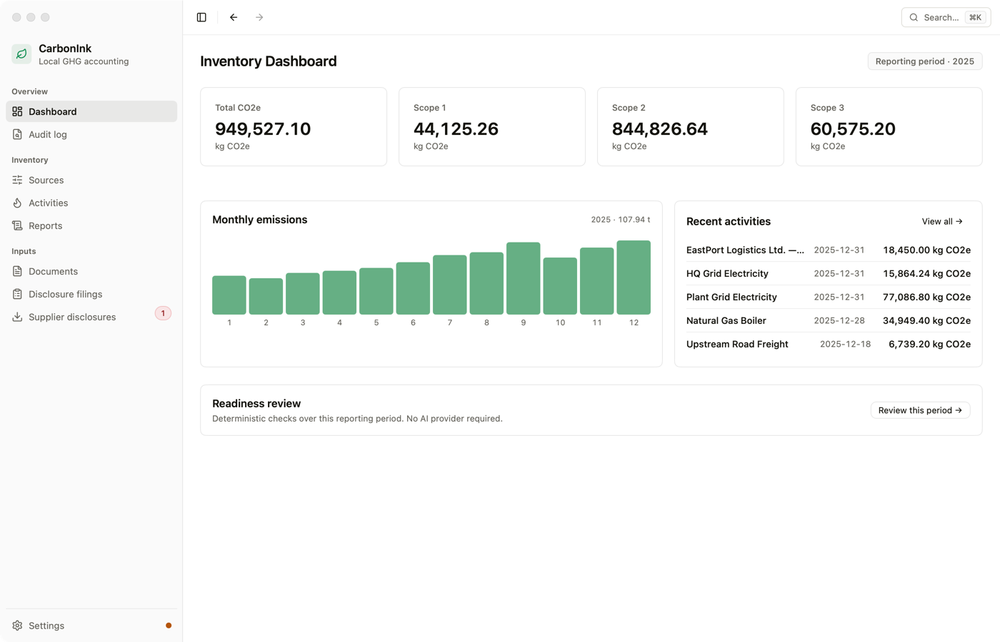

# CarbonInk · 碳墨

[](LICENSE)
[](https://github.com/lxzxl/carbonink/releases/latest)
[](https://github.com/lxzxl/carbonink/releases/latest)
[](https://github.com/lxzxl/carbonink/releases/latest)

**Free, open-source, local-first GHG accounting for the desktop.** CarbonInk 2.0 is a native macOS and Windows desktop app (~15–18 MB installers, built-in auto-updates) that runs entirely offline on a local SQLite database. Import bills or whole activity ledgers, let AI extract and match data, and export audit-ready ISO 14064-1 or TCFD reports — no account, no cloud, no subscription.

> Licensed under the [MIT License](LICENSE). Runs fully offline; your inventory data never leaves your device.



## Download

Grab the latest native installer from [GitHub Releases](https://github.com/lxzxl/carbonink/releases/latest) or [carbonink.xyz/download/](https://carbonink.xyz/download/). No activation key required.

- **macOS 13+ (Ventura or later):** Apple Silicon (`.dmg`, ~15.5 MB) and Intel (`.dmg`, ~17.7 MB)
- **Windows 10/11 (64-bit):** Installer (`.exe`, ~17.1 MB)
- **Automatic updates:** Built in via Sparkle (macOS) and WinSparkle (Windows) under **Settings → Software updates**.
- **First launch (unsigned open-source builds):** On macOS, right-click the app → **Open**; on Windows SmartScreen, choose **More info → Run anyway**.

### Upgrading from 1.x (Electron)

- CarbonInk 1.x cannot auto-update into 2.0 in place — download and install the 2.0 release once.
- On first launch, CarbonInk 2.0 automatically copies your existing 1.x workspaces, SQLite databases, uploads, and backups read-only, leaving the 1.x data directory untouched.
- Provider metadata carries over automatically; re-enter your LLM API key once in **Settings → AI provider**.

## What it does

- **Inventory, Batch Import & Audit Lineage** — manage emission sources and activity ledgers across Scope 1 / 2 / 3 and ISO 14064-1 Categories 1–6; bulk-import `.xlsx`/`.csv` ledgers with bilingual column auto-mapping, anomaly checks, and group-level human-confirmed EF matching; use built-in factors (IPCC AR6, DEFRA, US EPA eGRID, China MEE) or import custom `.xlsx`/`.csv` EF libraries, with pinned calculation snapshots and end-to-end evidence lineage.
- **AI Extraction (BYOK)** — extract activity data from utility bills, fuel receipts, freight, travel, and purchase documents (single documents or batch queue, vision fallback for scanned PDFs, and a local LLM file cache). Bring your own key for OpenAI, Anthropic, Google Gemini, DeepSeek, Moonshot, or any OpenAI-compatible endpoint.
- **Outbound & Inbound Disclosures** — fill customer/rating-agency questionnaires from your inventory with an inspectable Answer Agent trace drawer (outbound), and collect supplier Scope 3 data across Cat 1, Cat 4, Cat 5, Cat 6 — or custom templates — via zero-account `.xlsx` email round-trips supporting Tier 1 (PCF with quantity inference), Tier 2 (allocated), and Tier 3 (activity data with FTS5 EF ranking) plus overdue tracking and one-click reminders (inbound).
- **Reports & Auditor Deliverable Bundles** — export ISO 14064-1:2018 & TCFD four-pillar reports (PDF + Excel appendix) with editable AI narratives, pre-export readiness checks, a custom report logo, and SHA-256 verified ZIP deliverable bundles for offline verification.
- **Multi-Client Workspaces & Native Desktop UX** — run isolated per-client SQLite databases with per-workspace daily auto-backups, command palette (`⌘K` / `Ctrl+K`), undo/redo, light & dark themes, and a bilingual English / 简体中文 interface.
- **Built-in MCP Server & Agent Skill** — bundled stdio MCP server (`--mcp`) and one-click `carbonink-mcp` Agent Skill setup in **Settings → MCP server** for Claude Desktop, Claude Code, Cursor, and Pi, with workspace-aware access and an agent session launcher.

## Build from source

Prerequisites: **Go 1.27+** (`app/go.mod`), Xcode command-line tools for macOS builds, and **Node.js 20+ / pnpm** for `cloud/web/`.

```bash
# CarbonInk 2.0 native desktop app (app/)
pnpm app:dev                     # hot-reloading native window
pnpm app:check                   # regenerate locales, vet, and check targets
pnpm app:test                    # Go + headless UI tests (go test && go tool nsgo test)
pnpm app:build                   # macOS arm64 build

# Marketing website (cloud/web/)
pnpm cloud:build:web             # build static Astro site
```

See [`AGENTS.md`](AGENTS.md) for repo conventions, [`app/README.md`](app/README.md) for desktop app details, and [`docs/`](docs/) for conventions and local design docs.

## Repo layout

| Path | What |
|---|---|
| `app/` | CarbonInk 2.0 native desktop app (Go / NSGo) |
| `cloud/web/` | Astro static marketing site ([carbonink.xyz](https://carbonink.xyz)) |
| `docs/` | Tracked conventions (`docs/conventions/`) and local-only design trail |

> Note: CarbonInk 1.x (Electron) is archived at branch `archive/v1-electron` and tag `v1.2.0`.
